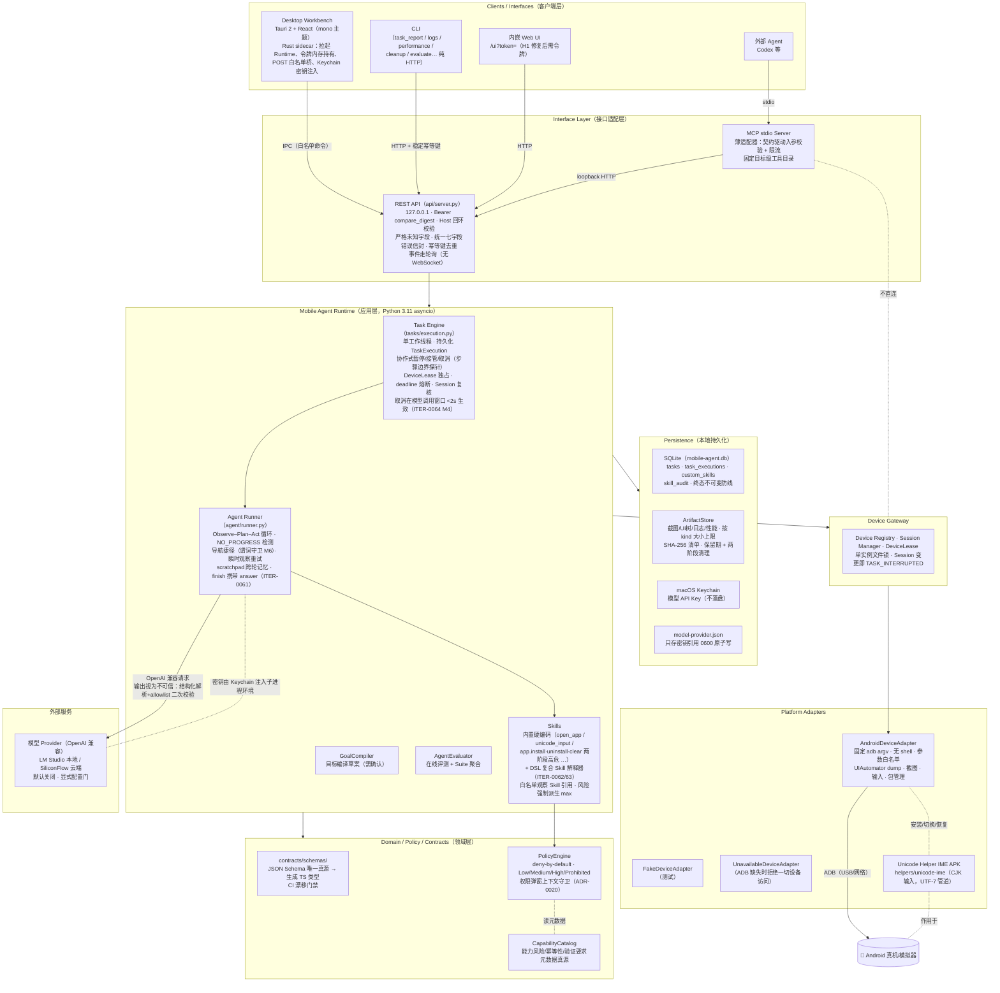
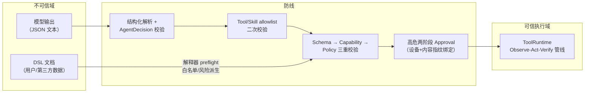
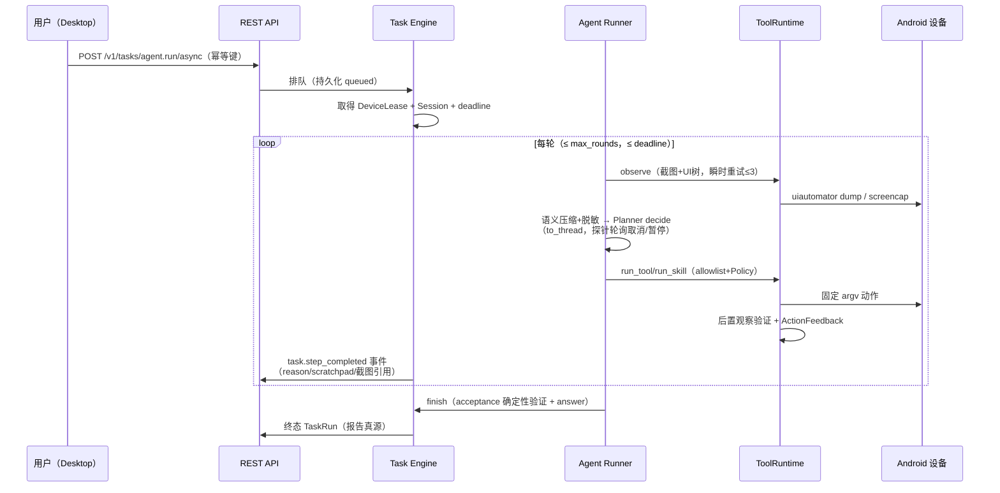

# ThumbAgent 当前架构图（实现态）

> 状态：Active
> 更新日期：2026-09-08（对照实现核对生成，非目标态）
> 范围：V1 + Agent 内核（ITER-0061）+ DSL 复合 Skill（ITER-0062/0063）+ 可靠性批次（ITER-0064）+ 稳定性报告（ITER-0065）

## 总体分层



## 信任边界与关键防线



## 关键数据流（一次 Agent 任务）



## 实现态与设计文档的差异（诚实标注）

| 设计文档说法 | 实现现状 |
| --- | --- |
| WebSocket 事件流 | 未实现；事件走 REST 轮询（1.2s 间隔） |
| `interfaces/mcp`、`interfaces/cli` 目录 | 实际在 `runtime/mobile_agent/mcp`、`runtime/mobile_agent/cli`（文档漂移已知） |
| iOS / 鸿蒙 Adapter 预留 | 仅有接口边界，无实现骨架 |
| Skill Manifest 声明与执行分离 | ITER-0062 前仅为测试夹具；DSL Skill 已真实解释执行，内置 Skill 仍为硬编码类 |

## 迭代脉络（架构视角）

```text
Runtime 骨架(0001) → 观察/动作/导航(0002-05) → 任务与证据(0006-12)
→ Agent 闭环与模型接入(0013-30) → 异步执行/租约/会话(0031-35)
→ 诊断能力(0036-39,43-48) → MCP 开放(0040) → 评测(0041-42,51)
→ 桌面工作台(0049-56) → 分发(0057) → 混合动作空间(0058-60)
→ Agent 内核(0061) → DSL Skill 平台(0062-63) → 可靠性(0064) → 报告呈现(0065)
```
